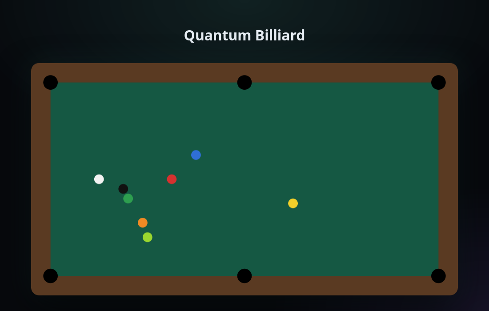

# Quantum Billiard

A browser billiard game in which every shot and every collision is a probability distribution instead of a deterministic line.



## Idea

In classical billiards, aiming perfectly means hitting perfectly. Here the direction of a shot is deflected by a random angle drawn from a distribution whose width grows with the shot's power: hit softly and the ball goes almost where you aim, hit hard and the outcome spreads out. Ball-ball collisions are deflected in the same way, so even a "clean" break stays unpredictable.

## Play

```bash
npm install
npm run dev
```

Then open the URL Vite prints.

- Move the cursor to aim. The ball is shot **away** from the cursor, like pulling back a slingshot.
- The distance between cursor and white ball sets the power (shown by the cue pull-back and the power meter).
- Click to shoot. You can only shoot while all balls are at rest.
- If the white ball is pocketed it respawns once everything has stopped.

## The math

The angular deviation `x` of a shot, in `[-pi, pi]`, is sampled by rejection sampling from

```
p(x) = G(x; sigma) + (1 - erf(pi / (sqrt(2) * sigma))) / (sigma * pi)

G(x; sigma) = exp(-x^2 / (2 * sigma^2)) / sqrt(2 * pi * sigma^2)
```

a Gaussian around the aimed direction plus a uniform offset (the mass of the Gaussian that would fall outside `[-pi, pi]`). The width `sigma` is mapped linearly from the shot speed to `[0, pi/2]`. Collisions rotate the impulse along the collision normal by an angle sampled from the same distribution, using the `sigma` of the last shot. See [`src/math.js`](src/math.js).

## Project structure

```
index.html          entry point
src/
  main.js           bootstrap and game loop
  config.js         tunable values and initial ball layout
  Game.js           game state, shooting, white ball respawn
  Physics.js        movement, friction, pockets, collisions
  Renderer.js       canvas rendering (table, balls, cue)
  Input.js          cursor tracking and shooting
  math.js           erf, gaussian, deviation sampling
.github/workflows/  CI and deployment
```

## Development

| Command                | Description                      |
| ---------------------- | -------------------------------- |
| `npm run dev`          | Start the Vite dev server        |
| `npm run build`        | Production build into `dist/`    |
| `npm run preview`      | Serve the production build       |
| `npm run lint`         | ESLint                           |
| `npm run format:check` | Prettier check (`format` to fix) |

### Workflow

- Work happens on branches named after the change type (`feat/...`, `fix/...`, `refactor/...`, `docs/...`, `ci/...`) and is merged into `dev` via pull request.
- `dev` is merged into `master`. A push to `master` triggers the deploy workflow, which builds the site and publishes it to the `deployment` branch (served via GitHub Pages).
- Commits follow [Conventional Commits](https://www.conventionalcommits.org/).

## Roadmap

- Correct and test the game physics ([#3](../../issues/3))
- Extendable settings menu ([#4](../../issues/4))
- More quantum effects such as tunneling ([#5](../../issues/5))
- Info page explaining the effects and their math ([#8](../../issues/8))

## License

See [LICENSE](LICENSE).
